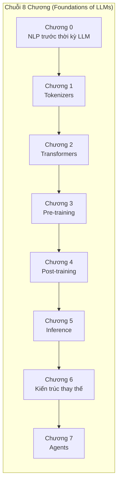

# Thiết kế Chi tiết Chuỗi bài giảng: Nền tảng Mô hình Ngôn ngữ Lớn (Foundations of LLMs — Học qua Thực hành)

Tài liệu này định nghĩa kiến trúc kỹ thuật và thiết kế nội dung chi tiết cho toàn bộ **8 phần (Chương 0 đến Chương 7)** của chuỗi bài giảng tương tác *"Nền tảng Mô hình Ngôn ngữ Lớn | Học qua Thực hành"* (dựa trên khóa học MVA của David Louapre tại ENS Paris-Saclay / Hugging Face), được Việt hóa hoàn chỉnh, bổ sung kiến thức chuyên sâu và xây dựng đồng bộ trên nền tảng Astro + MDX + D3.js + KaTeX.

---

## 1. Kiến trúc Đa chương & Quy chuẩn Phong cách ("Learning by Doing")

### Quy chuẩn từng chương
Mỗi chương tuân thủ nghiêm ngặt cấu trúc sư phạm của Chương 0 (`dlouapre/nlp-before-llms`):
1. **Header & Banner tương tác (`SeriesHeader.astro` + `banner-N.html`)**:
   - Thanh điều hướng chuỗi bài giảng hiển thị trạng thái cả 8 chương (0–7), cho phép chuyển chương trực tiếp ngay trong ứng dụng (`/` hoặc `/chapter-0` đến `/chapter-7`).
   - Mỗi chương có một `banner-N.html` minh họa trực quan bài toán cốt lõi ngay dưới tiêu đề.
2. **Dẫn nhập & Câu hỏi cốt lõi**:
   - Hộp `<Note variant="success">` giới thiệu mục tiêu thực hành của chương.
   - 2–3 câu hỏi nghiên cứu xuyên suốt chương.
   - Hộp `<Note title="Tập dữ liệu & Công cụ" emoji="📖" variant="info">` liệt kê các bộ dữ liệu và mô hình sử dụng.
3. **Hệ thống Mục lớn (`##`) & Mục con (`###`)**:
   - Giải thích trực giác trước, công thức toán học (KaTeX `$...$`, `$$...$$`) sau, dẫn dắt theo lịch sử phát triển ý tưởng.
4. **Biểu đồ tương tác D3.js (`<HtmlEmbed />`)**:
   - Mỗi chương có từ **4–6 biểu đồ D3.js tương tác** (`d3-chN-*.html`), tự động thích ứng Light/Dark mode qua biến CSS (`--text-color`, `--surface-bg`, `--border-color`) và `window.ColorPalettes`.
5. **Bài tập thực hành (`<Exercise />`)**:
   - Mỗi bài tập gồm: Đề bài, `<Starter />` (mã khởi tạo), `<Hints>` (gợi ý mở dần từng bước), `<Checkpoint>` (kết quả kỳ vọng & đầu ra chuẩn), `<Solution />` (lời giải đầy đủ < 70 ký tự/dòng + thời gian chạy), và `<WhatToNotice>` (nhận xét đúc kết sâu sắc).
6. **Ghi chú Bài báo Kinh điển (`<PaperNote />` & `[@key]`)**:
   - Đặt ở lề phải (Sidenote), tóm tắt bối cảnh lịch sử, quy mô mô hình, kết quả định lượng và mục `Xem thêm` (`look`) chỉ rõ Hình/Bảng đáng đọc trong bài báo gốc.
7. **Đọc thêm (`<Optional />`) & Bài tập Mở rộng (`<Bonus />`)**:
   - Các nhánh kiến thức nâng cao (màu xanh lá) và bài tập thử thách cuối chương.

---

## 2. Thiết kế Chi tiết Từng Chương (Chương 0 – Chương 7)

### Chương 0: Xử lý Ngôn ngữ Tự nhiên trước thời kỳ LLM (`NLP trước thời kỳ LLM`)
- **Đường dẫn**: `/` (và `/chapter-0`)
- **Nội dung**: Dịch thuật chuẩn xác, tự nhiên và bổ sung chú giải thuật ngữ tiếng Việt cho toàn bộ 12 file chương mục gốc (`00-introduction.mdx` đến `11-references.mdx`), 20 bài tập thực hành (`02-1` đến `10-2b`) và 23 biểu đồ tương tác D3 (`d3-*.html`).
- **Các phần chính**:
  - `00`: Giới thiệu & Hai câu hỏi lớn của NLP
  - `01`: Các bài toán điển hình của NLP (Phân loại, Mô hình hóa ngôn ngữ, Dịch máy, Gán nhãn)
  - `02`: Đếm từ và mô hình n-gram (Xích Markov, Perplexity, Làm mịn Laplace & nội suy)
  - `03`: Túi từ (Bag of Words, TF-IDF, Các bài đánh giá khó có phủ định & mỉa mai)
  - `04`: Biểu diễn từ dạng vector đặc (Embeddings, Mô hình ngôn ngữ nơ-ron Bengio 2003, Deep Averaging Network)
  - `05`: Tiền huấn luyện biểu diễn từ (Giả thuyết phân bố, Word2Vec CBOW/Skip-gram, GloVe, Phép loại suy vector)
  - `06`: Khúc dạo giữa: Nhìn lại chặng đường & Hiện tượng đa nghĩa (Polysemy)
  - `07`: Mạng nơ-ron truy hồi (RNN, Triệt tiêu đạo hàm, LSTM cho phân loại và sinh văn bản)
  - `08`: Tiền huấn luyện bộ mã hóa (Dai & Le, ULMFiT, ELMo và vector ngữ cảnh)
  - `09`: Chuỗi sang chuỗi và Cơ chế Chú ý (Seq2Seq Encoder-Decoder, Nút cổ chai độ dài, Attention của Bahdanau)
  - `10`: Lời kết: Transformers kế thừa câu chuyện như thế nào (Self-Attention, BERT, GPT-1/2/3, InstructGPT)

---

### Chương 1: Bộ tách từ (`Tokenizers`)
- **Đường dẫn**: `/chapter-1`
- **Câu hỏi cốt lõi**:
  1. *Tại sao mô hình ngôn ngữ không làm việc trực tiếp trên từng từ hay từng ký tự/byte thô?*
  2. *Làm thế nào để xây dựng bộ từ vựng con (subword vocabulary) cân bằng giữa độ dài chuỗi và khả năng biểu diễn mọi ngôn ngữ (kể cả tiếng Việt, mã nguồn, toán học)?*
- **Banner (`banner-1.html`)**: Trình khám phá tách từ trực tiếp (Live Tokenizer Inspector) so sánh cùng một câu tiếng Việt & tiếng Anh qua GPT-2 BPE, Llama-3/GPT-4 (`cl100k_base`) và BERT WordPiece, hiển thị số lượng token, tỷ lệ nén (bytes/token) và màu sắc từng token.
- **Các mục & Biểu đồ D3 & Bài tập**:
  - **1. Bài toán biểu diễn văn bản đầu vào**: Từ mức từ (Word-level, lỗi `<unk>`), mức ký tự (Character-level, chuỗi quá dài) đến mức từ phụ (Subword-level).
    - *D3 Embed*: `d3-ch1-granularity.html` — So sánh trực quan độ dài chuỗi ($L$) và kích thước từ vựng ($|V|$) giữa Character, Subword và Word.
  - **2. Byte-Pair Encoding (BPE)**: Thuật toán nén của Gage (1994) được Sennrich et al. (2016) đưa vào dịch máy nơ-ron.
    - *PaperNote*: `sennrich2016` (Subword NMT).
    - *D3 Embed*: `d3-ch1-bpe-merges.html` — Mô phỏng từng bước gộp cặp (merge tree) của thuật toán BPE trên một đoạn văn bản.
    - *Bài tập 1.2a (`ch1-01-char-byte`)*: Khám phá bảng mã UTF-8, độ dài byte của tiếng Việt có dấu so với tiếng Anh và hiện tượng đứt gãy ký tự đa byte.
    - *Bài tập 1.2b (`ch1-02-bpe-from-scratch`)*: Cài đặt thuật toán BPE từ đầu bằng Python thuần, huấn luyện trên tập văn bản và đo tỷ lệ nén (compression ratio) theo số lần gộp.
  - **3. Byte-level BPE & Pre-tokenization (GPT-2 đến GPT-4/Llama 3)**: Tại sao cần tách sơ bộ bằng Regex (`tiktoken`) trước khi gộp BPE trên byte?
    - *PaperNote*: `radford2019` (Byte-level BPE trong GPT-2).
    - *D3 Embed*: `d3-ch1-regex-splits.html` — Minh họa cách biểu thức chính quy (Regex) của GPT-2/GPT-4 ngăn việc gộp dấu câu vào từ và tách chữ số.
    - *Bài tập 1.3 (`ch1-03-pretokenization`)*: Xử lý lỗi gộp từ xuyên khoảng trắng bằng Regex pre-tokenizer kiểu GPT-2/GPT-4 và so sánh chất lượng từ vựng.
  - **4. WordPiece, Unigram LM và SentencePiece**: Các hướng tiếp cận xác suất (Schuster & Nakajima 2012, Kudo 2018, Kudo & Richardson 2018).
    - *PaperNote*: `kudo2018` (Subword Regularization & Unigram LM), `kudo2018sentencepiece` (SentencePiece).
    - *Optional*: *Byte-free / Tokenizer-free models (ByT5, MegaByte, Byte Latent Transformer)*.
  - **5. Các hệ quả thực tế và "Glitch Tokens"**: Tại sao LLM từng đếm chữ cái sai ("strawberry"), làm toán kém với số nhiều chữ số, và bất bình đẳng chi phí token giữa các ngôn ngữ (Fertility rate của tiếng Việt).
    - *D3 Embed*: `d3-ch1-fertility.html` — Biểu đồ so sánh chi phí token (fertility / bytes per token) trên cùng một nội dung đa ngôn ngữ (Anh, Pháp, Việt, Trung, Python) qua các thế hệ tokenizer.
    - *Bài tập 1.5 (`ch1-04-fertility-vietnamese`)*: Đo lường hệ số phân mảnh (fertility) trên văn bản tiếng Việt và tiếng Anh bằng thư viện `tokenizers` / `tiktoken`, và huấn luyện một BPE mở rộng cho tiếng Việt.

---

### Chương 2: Kiến trúc Transformer (`Transformers`)
- **Đường dẫn**: `/chapter-2`
- **Câu hỏi cốt lõi**:
  1. *Bên trong một khối Transformer Decoder hiện đại (như Llama-3, Qwen, Gemma) thực sự gồm những phép toán ma trận nào?*
  2. *Tại sao kiến trúc gốc năm 2017 của Vaswani et al. được tinh chỉnh thành công thức chuẩn ngày nay (Pre-RMSNorm, RoPE, SwiGLU, GQA)?*
- **Banner (`banner-2.html`)**: Sơ đồ luồng tensor (Interactive Tensor Shape & Residual Stream Inspector) đi qua một khối Decoder Transformer hiện đại: di chuột vào từng thành phần (RMSNorm, QKV Projection, RoPE, Causal Attention, GQA, SwiGLU, Residual Stream) để xem phương trình và kích thước tensor $(B, L, d_{\text{model}})$.
- **Các mục & Biểu đồ D3 & Bài tập**:
  - **1. Scaled Dot-Product Attention & Causal Mask**: Từ cơ chế tra cứu mềm $(Q, K, V)$, hệ số chia $\sqrt{d_k}$ giữ phương sai ổn định, đến mặt nạ nhân quả (causal mask) cho sinh văn bản tự hồi quy.
    - *PaperNote*: `vaswani2017` (Attention Is All You Need).
    - *D3 Embed*: `d3-ch2-qkv-attention.html` — Mô phỏng tương tác phép nhân $QK^\top / \sqrt{d_k}$, áp dụng Causal Mask $-\infty$, hàm Softmax và tổ hợp tuyến tính của $V$.
    - *Bài tập 2.1 (`ch2-01-causal-attention`)*: Cài đặt Scaled Dot-Product Causal Self-Attention bằng PyTorch và kiểm chứng tính nhân quả (thay đổi các token tương lai không làm đổi vector ở quá khứ).
  - **2. Multi-Head Attention (MHA) và Luồng thặng dư (Residual Stream)**: Tại sao nhiều đầu chú ý trong không gian con nhỏ hơn lại hiệu quả hơn một đầu lớn? Góc nhìn mạch cơ học (Mechanistic Interpretability) về Residual Stream.
    - *PaperNote*: `elhage2021` (A Mathematical Framework for Transformer Circuits).
    - *Bài tập 2.2 (`ch2-02-multihead-attention`)*: Cài đặt Multi-Head Attention với một phép nhân tensor 4 chiều duy nhất và trực quan hóa bản đồ chú ý của từng head.
  - **3. Mã hóa vị trí: Từ Sinusoidal đến Rotary Position Embedding (RoPE)**: Tại sao vị trí tương đối quan trọng hơn vị trí tuyệt đối? Cách RoPE quay các cặp tọa độ của $Q$ và $K$ trong mặt phẳng phức.
    - *PaperNote*: `su2024` (RoFormer: Enhanced Transformer with Rotary Position Embedding), `press2021` (ALiBi).
    - *D3 Embed*: `d3-ch2-rope-rotation.html` — Trực quan hóa phép quay vector 2D của RoPE ở các tần số $\theta_i$ khác nhau và cách tích vô hướng $\langle R_m q, R_n k \rangle$ chỉ phụ thuộc vào khoảng cách $m - n$.
    - *Bài tập 2.3 (`ch2-03-rope`)*: Cài đặt RoPE và kiểm chứng bằng thực nghiệm rằng điểm chú ý giữa hai token bất kỳ chỉ phụ thuộc vào khoảng cách tương đối $m - n$.
  - **4. Mạng Feed-Forward, Chuẩn hóa và Công thức Llama hiện đại**: Pre-Norm vs Post-Norm, RMSNorm, hàm kích hoạt SwiGLU và kiến trúc hoàn chỉnh của một khối Transformer.
    - *PaperNote*: `xiong2020` (Pre-LN vs Post-LN), `zhang2019` (RMSNorm), `shazeer2020` (GLU Variants / SwiGLU).
    - *D3 Embed*: `d3-ch2-norm-activations.html` — So sánh dòng chảy gradient của Post-LN vs Pre-LN và hình dạng hàm kích hoạt ReLU, GELU, SwiGLU.
  - **5. Đếm tham số và FLOPs của một mô hình ngôn ngữ**: Phân bổ tham số giữa Embedding, Attention và FFN; tại sao quy tắc $6ND$ lại đúng?
    - *D3 Embed*: `d3-ch2-param-flops.html` — Máy tính tương tác phân rã số lượng tham số và FLOPs của GPT-2, Llama-3 8B, Llama-3 70B theo từng lớp.
    - *Bài tập 2.5 (`ch2-04-gpt-block`)*: Lắp ráp hoàn chỉnh một mô hình Mini-Llama (RMSNorm + RoPE + Causal MHA + SwiGLU), kiểm tra bảng phân bổ tham số và huấn luyện thử trên tập văn bản nhỏ.

---

### Chương 3: Tiền huấn luyện (`Pre-training`)
- **Đường dẫn**: `/chapter-3`
- **Câu hỏi cốt lõi**:
  1. *Làm thế nào để biến hàng nghìn tỷ từ thô trên Internet thành một mô hình ngôn ngữ nền tảng (base model)?*
  2. *Với ngân sách tính toán cố định $C$ (FLOPs), ta nên chọn mô hình lớn hơn hay huấn luyện trên nhiều dữ liệu hơn?*
- **Banner (`banner-3.html`)**: Máy tính tương tác Định luật Mở rộng Chinchilla (Interactive Chinchilla Scaling Law Explorer): kéo thanh trượt ngân sách tính toán $C$ (từ $10^{17}$ đến $10^{25}$ FLOPs) để xem kích thước mô hình tối ưu $N_{\text{opt}}$, lượng token tối ưu $D_{\text{opt}}$, và hàm mất mát dự kiến $L(N, D)$.
- **Các mục & Biểu đồ D3 & Bài tập**:
  - **1. Bài toán Tiền huấn luyện và Chuẩn bị Batch dữ liệu**: Hàm mất mát Cross-Entropy tự hồi quy, đóng gói tài liệu (document packing) với token `<|endoftext|>`, và dịch chuyển chuỗi (input/target shift).
    - *D3 Embed*: `d3-ch3-doc-packing.html` — Minh họa cách nối các văn bản có độ dài khác nhau thành các cửa sổ ngữ cảnh cố định $L$ mà không lãng phí phép tính cho padding.
    - *Bài tập 3.1 (`ch3-01-data-packing`)*: Xây dựng bộ nạp dữ liệu đóng gói (packed dataloader) trên WikiText-2 và so sánh hiệu suất sử dụng token so với cách đệm (padding) truyền thống.
  - **2. Quy trình Lọc và Làm sạch Dữ liệu Web quy mô lớn**: Từ CommonCrawl đến FineWeb (Lọc URL, tách văn bản từ HTML, lọc ngôn ngữ, khử trùng lặp MinHash LSH, lọc chất lượng bằng bộ phân loại).
    - *PaperNote*: `raffel2020` (T5 & C4), `penedo2024` (The FineWeb Datasets).
    - *D3 Embed*: `d3-ch3-data-pipeline.html` — Phễu lọc dữ liệu tương tác của FineWeb: theo dõi tỷ lệ dữ liệu giữ lại và sự cải thiện điểm benchmark qua từng tầng lọc.
    - *Bài tập 3.2 (`ch3-02-minhash-dedup`)*: Cài đặt thuật toán khử trùng lặp gần đúng (Near-deduplication) bằng n-gram Jaccard & MinHash trên một tập văn bản chứa các đoạn lặp lại.
  - **3. Động lực học Huấn luyện & Tối ưu hóa**: AdamW, lịch trình tốc độ học Cosine với giai đoạn khởi động (Warmup + Cosine / WSD), cắt chuẩn đạo hàm (Gradient Clipping), tích lũy đạo hàm (Gradient Accumulation) và độ chính xác hỗn hợp `bfloat16`.
    - *PaperNote*: `loshchilov2019` (Decoupled Weight Decay Regularization — AdamW), `micikevicius2018` (Mixed Precision Training).
    - *D3 Embed*: `d3-ch3-lr-schedules.html` — Trực quan hóa lịch trình tốc độ học (Warmup + Cosine vs Warmup-Stable-Decay WSD) và quỹ đạo giảm hàm mất mát.
    - *Bài tập 3.3 (`ch3-03-training-loop`)*: Huấn luyện mô hình Transformer nhỏ với AdamW, lịch trình Warmup + Cosine và Gradient Clipping, so sánh sự ổn định hội tụ.
  - **4. Định luật Mở rộng (Scaling Laws — Kaplan vs Chinchilla)**: Hàm mất mát giảm theo luật hàm mũ $L(N, D) = E + A N^{-\alpha} + B D^{-\beta}$; tại sao GPT-3 (175B, 300B tokens) bị thiếu dữ liệu và cách Chinchilla (70B, 1.4T tokens) thay đổi cuộc chơi; xu hướng huấn luyện vượt ngưỡng Chinchilla (over-training như Llama-3 8B trên 15T tokens) để tối ưu chi phí suy luận.
    - *PaperNote*: `kaplan2020` (Scaling Laws for Neural Language Models), `hoffmann2022` (Training Compute-Optimal Large Language Models — Chinchilla).
    - *D3 Embed*: `d3-ch3-chinchilla-isoflops.html` — Đường đồng mức IsoFLOPs và biên Pareto giữa $N$ (số tham số) và $D$ (số token), bao gồm cả điểm tối ưu khi tính thêm chi phí suy luận.
    - *Bài tập 3.4 (`ch3-04-scaling-law-fit`)*: Khớp đường cong luật hàm mũ $L(N, D)$ từ dữ liệu thực nghiệm IsoFLOPs và dự đoán cấu hình $(N^*, D^*)$ tối ưu cho một ngân sách FLOPs cho trước.
  - **5. Huấn luyện Phân tán (Distributed Training)**: Data Parallelism, ZeRO/FSDP (cắt nhỏ trạng thái optimizer, gradient, tham số), Tensor Parallelism và Pipeline Parallelism.
    - *PaperNote*: `rajbhandari2020` (ZeRO: Memory Optimizations Toward Training Trillion Parameter Models), `shoeybi2019` (Megatron-LM).

---

### Chương 4: Hậu huấn luyện và Căn chỉnh (`Post-training`)
- **Đường dẫn**: `/chapter-4`
- **Câu hỏi cốt lõi**:
  1. *Tại sao một mô hình tiền huấn luyện (base model) biết rất nhiều kiến thức nhưng lại không thể trò chuyện như một trợ lý hữu ích?*
  2. *Làm thế nào để dạy mô hình tuân theo chỉ dẫn (SFT), học từ sở thích của con người (RLHF / DPO) và tự suy luận từng bước (Reasoning RL / GRPO)?*
- **Banner (`banner-4.html`)**: So sánh trực tiếp phản hồi của 3 giai đoạn mô hình (**Base Model** vs **SFT Model** vs **Aligned/Reasoning Model**) trên cùng một câu hỏi của người dùng, hiển thị xác suất từng token và điểm thưởng (reward score).
- **Các mục & Biểu đồ D3 & Bài tập**:
  - **1. Tinh chỉnh có giám sát (Supervised Fine-Tuning — SFT) & Chat Templates**: Định dạng hội thoại (`<|im_start|>user...`), tại sao chỉ tính hàm mất mát trên các token của `assistant` (loss masking), và giả thuyết căn chỉnh bề mặt (Superficial Alignment Hypothesis — LIMA).
    - *PaperNote*: `wei2022flan` (FLAN / Instruction Tuning), `zhou2023lima` (LIMA: Less Is More for Alignment).
    - *D3 Embed*: `d3-ch4-sft-masking.html` — Trực quan hóa chuỗi hội thoại nhiều lượt và mặt nạ hàm mất mát (loss mask = 0 cho system/user, 1 cho assistant).
    - *Bài tập 4.1 (`ch4-01-sft-loss-mask`)*: Xây dựng hàm tạo mẫu hội thoại (chat template) và tính hàm mất mát SFT có che mặt nạ (masked cross-entropy) chỉ trên phần trả lời của trợ lý.
  - **2. Tinh chỉnh hiệu quả tham số (PEFT & LoRA / QLoRA)**: Chiều nội tại thấp (low intrinsic dimension) của quá trình tinh chỉnh; phân rã ma trận cập nhật $\Delta W = B A$ với hạng $r \ll d$.
    - *PaperNote*: `hu2022` (LoRA: Low-Rank Adaptation of Large Language Models), `dettmers2023qlora` (QLoRA).
    - *D3 Embed*: `d3-ch4-lora-matrix.html` — Mô phỏng trực quan nhánh song song $W_0 x + \frac{\alpha}{r} B A x$ và bộ tính tiết kiệm VRAM khi thay đổi hạng $r \in \{4, 8, 16, 64\}$.
    - *Bài tập 4.2 (`ch4-02-lora-layer`)*: Cài đặt lớp `LoRALinear` từ đầu bằng PyTorch, đóng băng trọng số gốc và chứng minh chỉ cần huấn luyện < 1% tham số vẫn đạt độ chính xác tương đương.
  - **3. Học tăng cường từ phản hồi con người (RLHF: Mô hình Phần thưởng & PPO)**: Mô hình sở thích Bradley–Terry $P(y_w \succ y_l \mid x) = \sigma(r_\phi(x, y_w) - r_\phi(x, y_l))$, tối ưu chính sách với ràng buộc phân kỳ KL $\max_\pi \mathbb{E}[r(x, y)] - \beta D_{\text{KL}}(\pi_\theta \,\|\, \pi_{\text{ref}})$ để chống "hack phần thưởng" (reward hacking).
    - *PaperNote*: `christiano2017` (Deep RL from Human Preferences), `ouyang2022` (InstructGPT).
    - *D3 Embed*: `d3-ch4-rlhf-kl.html` — Đồ thị tương tác biên độ giữa Điểm thưởng $r(x, y)$ và Phân kỳ KL $D_{\text{KL}}(\pi_\theta \| \pi_{\text{ref}})$, minh họa hiện tượng Reward Hacking khi $\beta \to 0$.
  - **4. Tối ưu hóa Sở thích Trực tiếp (Direct Preference Optimization — DPO)**: Biến đổi đại số của Rafailov et al. (2023) giúp loại bỏ hoàn toàn mô hình phần thưởng riêng biệt, biến RLHF thành hàm mất mát phân loại nhị phân trực tiếp trên cặp $(y_w, y_l)$.
    - *PaperNote*: `rafailov2023` (Direct Preference Optimization: Your Language Model is Secretly a Reward Model).
    - *Bài tập 4.4 (`ch4-03-dpo-loss`)*: Cài đặt hàm mất mát DPO và huấn luyện tinh chỉnh mô hình ưu tiên câu trả lời lịch sự, chính xác thay vì câu trả lời độc hại/sai lệch.
  - **5. Học tăng cường với Phần thưởng Kiểm chứng được (RLVR & GRPO — DeepSeek-R1)**: Khi bài toán có đáp án kiểm chứng được (toán học, lập trình), thay thế mô hình phần thưởng bằng bộ chấm tự động và ước lượng lợi thế theo nhóm (Group Relative Policy Optimization — GRPO).
    - *PaperNote*: `shao2024deepseekmath` (DeepSeekMath & GRPO), `deepseek2025r1` (DeepSeek-R1: Incentivizing Reasoning Capability in LLMs via RL).
    - *Bài tập 4.5 (`ch4-04-grpo-advantage`)*: Cài đặt bộ tính lợi thế chuẩn hóa theo nhóm (Group Relative Advantage) và bước cập nhật GRPO cho bài toán suy luận số học.

---

### Chương 5: Suy luận và Tối ưu hóa (`Inference`)
- **Đường dẫn**: `/chapter-5`
- **Câu hỏi cốt lõi**:
  1. *Tại sao khi sinh từng token, tốc độ của LLM không bị giới hạn bởi sức mạnh tính toán (FLOP/s) của GPU mà bởi băng thông bộ nhớ (Memory Bandwidth)?*
  2. *Làm thế nào các kỹ thuật chọn mẫu (Sampling), KV Cache, GQA, FlashAttention, Lượng tử hóa và Giải mã suy đoán (Speculative Decoding) giúp tăng tốc LLM lên hàng chục lần?*
- **Banner (`banner-5.html`)**: Mô phỏng trực tiếp hai pha suy luận (**Prefill: Compute-bound** vs **Decode: Memory-bound**) với đồng hồ đo tốc độ (tokens/s), dung lượng KV Cache tăng dần và biểu đồ Roofline thời gian thực.
- **Các mục & Biểu đồ D3 & Bài tập**:
  - **1. Chiến lược Giải mã & Chọn mẫu (Decoding & Sampling)**: Greedy vs Beam Search, Temperature $T$, Top-$k$, và Top-$p$ (Nucleus Sampling — Holtzman et al. 2020) để tránh vòng lặp nhàm chán hoặc văn bản vô nghĩa.
    - *PaperNote*: `holtzman2020` (The Curious Case of Neural Text Degeneration — Top-p Nucleus Sampling).
    - *D3 Embed*: `d3-ch5-sampling.html` — Sân chơi phân phối xác suất token tiếp theo: điều chỉnh thanh trượt Temperature $T$, Top-$k$, và Top-$p$ để xem các ứng viên được giữ lại và chuẩn hóa lại xác suất.
    - *Bài tập 5.1 (`ch5-01-top-p-sampling`)*: Cài đặt bộ chọn mẫu kết hợp Temperature + Top-$k$ + Top-$p$ (Nucleus Sampling) và so sánh sự đa dạng văn bản sinh ra.
  - **2. Bộ nhớ đệm KV (KV Cache) & Hai pha Prefill / Decode**: Tại sao tính lại toàn bộ chuỗi tốn $O(L^2)$ mỗi bước? Lưu trữ $K, V$ của các token trước đó giảm độ phức tạp xuống $O(L)$, nhưng biến suy luận thành bài toán nghẽn băng thông bộ nhớ (Arithmetic Intensity — Mô hình Roofline).
    - *D3 Embed*: `d3-ch5-kv-cache-roofline.html` — Trực quan hóa ma trận KV Cache phát triển theo chiều dài chuỗi và biểu đồ Roofline (FLOPs/Byte) so sánh pha Prefill và pha Decode.
    - *Bài tập 5.2 (`ch5-02-kv-cache`)*: Cài đặt suy luận tự hồi quy có và không có KV Cache, đo tốc độ tăng tốc thực tế và lượng bộ nhớ tiêu thụ theo độ dài chuỗi $L$.
  - **3. Thu gọn KV Cache: Multi-Query (MQA), Grouped-Query (GQA) & PagedAttention**: Chia sẻ các đầu Key/Value giữa nhiều đầu Query (Shazeer 2019, Ainslie et al. 2023) và quản lý bộ nhớ phân trang kiểu hệ điều hành trong vLLM (Kwon et al. 2023).
    - *PaperNote*: `shazeer2019mqa` (Fast Transformer Decoding — MQA), `ainslie2023gqa` (GQA), `kwon2023vllm` (PagedAttention & vLLM).
    - *D3 Embed*: `d3-ch5-mha-mqa-gqa.html` — So sánh trực quan sơ đồ nối đầu chú ý và dung lượng VRAM của KV Cache giữa MHA, GQA và MQA.
  - **4. FlashAttention & Lượng tử hóa Trọng số (Quantization INT8/INT4)**: Tại sao tránh ghi ma trận $L \times L$ ra HBM bằng Online Softmax lại tăng tốc đột phá (Dao et al. 2022)? Lượng tử hóa Absmax/Zero-point, LLM.int8(), GPTQ và AWQ.
    - *PaperNote*: `dao2022flashattention` (FlashAttention), `dettmers2022llmint8` (LLM.int8()), `frantar2023gptq` (GPTQ), `lin2024awq` (AWQ).
    - *Bài tập 5.4 (`ch5-03-int8-quantization`)*: Cài đặt lượng tử hóa trọng số theo nhóm (Group-wise INT8/INT4 Quantization) và đo sai số tái tạo cùng mức giảm bộ nhớ.
  - **5. Giải mã Suy đoán (Speculative Decoding)**: Dùng một mô hình nháp nhỏ (Draft Model) đoán trước $\gamma$ token và dùng mô hình lớn kiểm tra song song trong 1 bước duy nhất, bảo toàn chính xác 100% phân phối gốc (Leviathan et al. 2023).
    - *PaperNote*: `leviathan2023speculative` (Fast Inference from Transformers via Speculative Decoding).
    - *D3 Embed*: `d3-ch5-speculative-decoding.html` — Mô phỏng từng bước Draft-and-Verify và tính hệ số tăng tốc theo tỷ lệ chấp nhận $\alpha$.
    - *Bài tập 5.5 (`ch5-04-speculative-decoding`)*: Cài đặt thuật toán Rejection Sampling của Speculative Decoding và kiểm chứng phân phối đầu ra trùng khớp với mô hình đích.

---

### Chương 6: Các Kiến trúc Thay thế (`Alternative architectures`)
- **Đường dẫn**: `/chapter-6`
- **Câu hỏi cốt lõi**:
  1. *Làm thế nào để tăng sức chứa tham số của mô hình lên hàng trăm tỷ mà chỉ kích hoạt một phần nhỏ tham số cho mỗi token (Mixture of Experts)?*
  2. *Liệu ta có thể vượt qua nút cổ chai bậc hai $O(L^2)$ của Softmax Attention bằng Attention tuyến tính, Mô hình Không gian Trạng thái (SSM / Mamba) hoặc Mô hình Khuếch tán Văn bản (Diffusion LMs)?*
- **Banner (`banner-6.html`)**: Bộ so sánh trực quan Độ phức tạp Tính toán & Bộ nhớ theo chiều dài ngữ cảnh $L$ (từ $1\text{K}$ đến $1\text{M}$ tokens) giữa **Dense Transformer**, **Sparse MoE**, **Linear Attention / Mamba (SSM)** và **Hybrid Architecture**.
- **Các mục & Biểu đồ D3 & Bài tập**:
  - **1. Hỗn hợp Chuyên gia Thưa (Sparse Mixture of Experts — MoE)**: Thay lớp FFN đặc bằng $E$ chuyên gia và bộ định tuyến (Router) chọn Top-$k$ chuyên gia mỗi token; bài toán cân bằng tải (Load Balancing Loss) và chuyên gia dùng chung (Shared Experts trong Mixtral, DeepSeek-V3).
    - *PaperNote*: `shazeer2017moe` (Outrageously Large Neural Networks), `fedus2022switch` (Switch Transformers), `jiang2024mixtral` (Mixtral of Experts), `deepseek2024v3` (DeepSeek-V3).
    - *D3 Embed*: `d3-ch6-moe-routing.html` — Mô phỏng luồng token đi qua bộ định tuyến Top-2 tới 8 chuyên gia và hiệu ứng sụp đổ định tuyến (routing collapse) khi thiếu cân bằng tải.
    - *Bài tập 6.1 (`ch6-01-sparse-moe`)*: Cài đặt lớp Sparse Top-$k$ MoE kèm hàm mất mát cân bằng tải (load-balancing auxiliary loss) và kiểm tra phân bố tần suất chuyên gia.
  - **2. Attention Tuyến tính & Sự đối ngẫu RNN–Attention (Linear Attention)**: Bỏ hàm mũ Softmax để đổi thứ tự nhân ma trận từ $(QK^\top)V$ ($O(L^2 d)$) sang $Q(K^\top V)$ ($O(L d^2)$), biến Attention thành một RNN có trạng thái ma trận $S_t = S_{t-1} + k_t v_t^\top$.
    - *PaperNote*: `katharopoulos2020` (Transformers are RNNs: Fast Autoregressive Transformers with Linear Attention), `peng2023rwkv` (RWKV).
    - *D3 Embed*: `d3-ch6-linear-attention-duality.html` — Minh họa trực quan hai chế độ tương đương toán học: Chế độ Song song khi huấn luyện $O(L^2)$ vs Chế độ Truy hồi trạng thái cố định $S_t \in \mathbb{R}^{d \times d}$ khi suy luận $O(1)$.
    - *Bài tập 6.2 (`ch6-02-linear-attention`)*: Cài đặt Linear Attention ở cả hai chế độ (Parallel form và Recurrent state form) và chứng minh chúng cho kết quả số học hoàn toàn giống nhau.
  - **3. Mô hình Không gian Trạng thái Chọn lọc (SSM & Mamba / Mamba-2)**: Từ hệ phương trình vi phân tuyến tính liên tục đến S4, và bước đột phá của Mamba (Gu & Dao 2023): làm cho các ma trận $(\Delta, B, C)$ phụ thuộc vào đầu vào (Selective Scan) để biết chọn lọc thông tin cần nhớ và cần quên.
    - *PaperNote*: `gu2022s4` (Efficiently Modeling Long Sequences with Structured State Spaces — S4), `gu2023mamba` (Mamba: Linear-Time Sequence Modeling with Selective State Spaces), `dao2024mamba2` (Transformers are SSMs — Mamba-2).
    - *D3 Embed*: `d3-ch6-selective-ssm.html` — Trực quan hóa cổng chọn lọc $\Delta_t$ của Mamba trên bài toán Sao chép Chọn lọc (Selective Copying): tự động mở cổng khi gặp token quan trọng và đóng cổng trước nhiễu.
    - *Bài tập 6.3 (`ch6-03-selective-ssm`)*: Cài đặt mô-đun Selective State Space (cơ chế Mamba đơn giản hóa) và so sánh với SSM bất biến thời gian (LTI) trên bài toán nhớ có chọn lọc.
  - **4. Kiến trúc Lai (Hybrid SSM-Transformer) & Mô hình Ngôn ngữ Khuếch tán (Diffusion LMs)**: Tại sao SSM gặp khó khăn khi tra cứu nguyên văn (in-context copying — Arora et al. 2024) và cách kết hợp vài lớp Attention với nhiều lớp Mamba (Jamba, Zamba); cùng hướng tiếp cận sinh văn bản song song bằng Masked Diffusion (MDLM, LLaDA).
    - *PaperNote*: `lieber2024jamba` (Jamba: A Hybrid Transformer-Mamba Language Model), `sahoo2024mdlm` (Simple and Effective Masked Diffusion Language Models).

---

### Chương 7: Tác tử Thông minh và Hệ thống LLM (`Agents`)
- **Đường dẫn**: `/chapter-7`
- **Câu hỏi cốt lõi**:
  1. *Làm thế nào để biến một mô hình chỉ biết dự đoán từ tiếp theo thành một hệ thống có khả năng tra cứu tri thức ngoài, sử dụng công cụ, viết và chạy mã, và tự lập kế hoạch giải quyết vấn đề phức tạp?*
  2. *Những giới hạn và rủi ro bảo mật (như Prompt Injection, tích lũy sai số nhiều bước) của hệ thống Agent là gì?*
- **Banner (`banner-7.html`)**: Trình mô phỏng trực quan Vòng lặp Tác tử (Interactive Agent Execution Trace): theo dõi một Agent giải quyết yêu cầu phức tạp qua chu trình `Suy nghĩ (Thought)` $\to$ `Gọi công cụ (Tool Call)` $\to$ `Quan sát kết quả (Observation)` $\to$ `Câu trả lời cuối cùng (Final Answer)`.
- **Các mục & Biểu đồ D3 & Bài tập**:
  - **1. Sinh văn bản tăng cường truy xuất (Retrieval-Augmented Generation — RAG)**: Khắc phục giới hạn kiến thức tĩnh (knowledge cutoff) và ảo giác (hallucination); so sánh tìm kiếm từ khóa BM25, tìm kiếm vector đặc (Dense Passage Retrieval) và Kết hợp Thứ bậc Nghịch đảo (Reciprocal Rank Fusion — RRF).
    - *PaperNote*: `lewis2020rag` (Retrieval-Augmented Generation for Knowledge-Intensive NLP Tasks), `karpukhin2020dpr` (Dense Passage Retrieval).
    - *D3 Embed*: `d3-ch7-hybrid-rag.html` — Minh họa đường ống Hybrid RAG: kết hợp điểm BM25 (khớp từ khóa chính xác) và Cosine Embedding (khớp ngữ nghĩa) qua công thức RRF.
    - *Bài tập 7.1 (`ch7-01-hybrid-rag`)*: Xây dựng công cụ tìm kiếm lai (BM25 + Dense Embeddings + Reciprocal Rank Fusion) trên kho tài liệu kỹ thuật và đánh giá độ chính xác truy xuất (Recall@k).
  - **2. Suy luận Chuỗi tư duy (Chain-of-Thought) & Mở rộng Tính toán lúc Suy luận (Test-Time Compute)**: Tại sao sinh ra các bước trung gian $z_1 \dots z_k$ lại mở rộng khả năng tính toán của Transformer? Self-Consistency (bầu chọn đa số) và Tree of Thoughts.
    - *PaperNote*: `wei2022cot` (Chain-of-Thought Prompting Elicits Reasoning in LLMs), `wang2023selfconsistency` (Self-Consistency), `yao2023tot` (Tree of Thoughts).
  - **3. Sử dụng Công cụ (Tool Use / Function Calling) & Giải mã có Ràng buộc (Constrained Decoding)**: Cách LLM học gọi API bên ngoài (Toolformer) và cách dùng máy trạng thái hữu hạn (FSM / Grammar Masking) ép đầu ra tuân thủ tuyệt đối lược đồ JSON.
    - *PaperNote*: `schick2023toolformer` (Toolformer: Language Models Can Teach Themselves to Use Tools), `willard2023outlines` (Efficient Guided Generation for LLMs).
    - *D3 Embed*: `d3-ch7-constrained-json.html` — Trực quan hóa mặt nạ logit (Grammar/FSM Logit Masking) ở từng bước giải mã để đảm bảo 100% sinh ra JSON hợp lệ khi gọi hàm.
    - *Bài tập 7.3 (`ch7-02-constrained-decoding`)*: Cài đặt bộ lọc mặt nạ token theo văn phạm (Constrained Token Masking) ép mô hình chỉ được sinh ra cấu trúc lệnh gọi hàm hợp lệ.
  - **4. Vòng lặp ReAct, Code Agents & Tự phản chiếu (Reflexion)**: Kết hợp Suy luận và Hành động (ReAct — Yao et al. 2023), viết mã Python làm hành động (CodeAct) và tự sửa lỗi từ thông báo ngoại lệ (Reflexion — Shinn et al. 2023).
    - *PaperNote*: `yao2023react` (ReAct: Synergizing Reasoning and Acting in Language Models), `shinn2023reflexion` (Reflexion: Language Agents with Verbal Reinforcement Learning).
    - *D3 Embed*: `d3-ch7-react-loop.html` — Sơ đồ trạng thái tương tác của vòng lặp ReAct + Reflexion khi giải bài toán phân tích dữ liệu nhiều bước.
    - *Bài tập 7.4 (`ch7-03-react-agent`)*: Xây dựng một vòng lặp ReAct Agent hoàn chỉnh có khả năng gọi công cụ máy tính (`calculator`), tra cứu tài liệu (`search`) và tự sửa lỗi khi công cụ trả về ngoại lệ.
  - **5. Đánh giá Tác tử, Định luật Sai số Tích lũy và Bảo mật (Prompt Injection)**: Tại sao độ tin cậy $p = 95\%$ mỗi bước lại giảm xuống $0.95^{20} \approx 36\%$ sau 20 bước? Các benchmark thực tế (SWE-bench) và cơ chế phòng vệ trước Indirect Prompt Injection.
    - *PaperNote*: `jimenez2024swebench` (SWE-bench: Can Language Models Resolve Real-World GitHub Issues?), `greshake2023promptinjection` (Indirect Prompt Injection).
    - *D3 Embed*: `d3-ch7-agent-reliability.html` — Biểu đồ tương tác sự suy giảm xác suất thành công theo số bước $k$ ($p^k$) và cách cơ chế kiểm tra/thử lại (Verifier + Retry) khôi phục độ tin cậy.
    - *Bài tập 7.5 (`ch7-04-prompt-injection-guard`)*: Mô phỏng một cuộc tấn công Indirect Prompt Injection qua dữ liệu truy xuất và xây dựng lớp kiểm duyệt tách biệt dữ liệu – chỉ dẫn.
