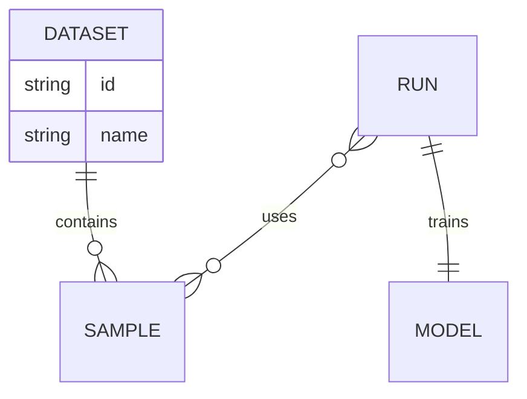

# Research Article Template -- How-To Guide

A single-page, MDX-first template for interactive scientific articles. Built with Astro 4, D3.js, and KaTeX. Produces responsive, dark-mode-aware web pages with automatic PDF export.

---

## 1. Getting Started

### Prerequisites

- **Node.js 20+** (use [nvm](https://github.com/nvm-sh/nvm) to manage versions)
- **Git LFS** (required for binary assets -- images, fonts, etc.)

### Installation

The recommended way is to **duplicate the Space** on Hugging Face:

1. Open [research-article-template](https://huggingface.co/spaces/tfrere/science-blog-template) and click **Duplicate this Space**.
2. Give it a name, choose visibility, keep the free CPU instance.
3. Clone your new Space:

```bash
git clone git@hf.co:spaces/<your-username>/<your-space>
cd <your-space>
```

4. Install Git LFS and pull binary files:

```bash
git lfs install
git lfs pull
```

5. Install dependencies:

```bash
cd app
npm install
```

> **Warning:** Pushing binary files without Git LFS installed will cause errors.

### Development

```bash
npm run dev
```

Dev server runs at `http://localhost:4321`.

### Building

```bash
npm run build
```

A `[slugified-title].pdf` and `thumb.jpg` are generated at build time in the `public/` folder.

### Deploying to Hugging Face Spaces

Every push triggers an automatic build and deploy:

```bash
git add .
git commit -m "Update content"
git push
```

The `dist/` directory can also be served on any static host.

### Template Synchronization

Keep your project up to date with the official template:

```bash
# Preview what would change
npm run sync:template -- --dry-run

# Apply updates (preserves your content in /src/content/)
npm run sync:template
```

**Preserved:** your content in `/src/content/`, `README.md`, `.gitignore`.
**Updated:** components, styles, configuration, Dockerfile, dependencies, build system, and the agent skills in `.ai/skills/`.

**Caution:** the sync copies every template file outside the preserved paths, so it brings back the demo files removed at initialization (`app/screenshots/`, `app/src/components/demo/`, `AGENTS.md`, `CHANGELOG.md`, etc.). It also overwrites `CLAUDE.md` and `.gitattributes` with the template's versions. Run the dry run first, then restore these two files with `git checkout` and delete the demo files again after syncing.

---

## 2. Content Structure

### article.mdx

The file `app/src/content/article.mdx` is the single entry point. It has two parts: a YAML **frontmatter** block and the **content** body written in MDX (Markdown + JSX components).

```mdx
---
title: "My Article Title"
subtitle: "A subtitle below the banner"
description: "SEO meta description."
published: "2025-06-01"
---

import Image from '../components/Image.astro';
import Sidenote from '../components/Sidenote.astro';

## First Section

Your markdown content here.

<Sidenote>A marginal note.</Sidenote>
```

### Frontmatter Schema

| Field | Required | Type | Default | Description |
|---|---|---|---|---|
| `title` | Yes | `string` | `"Untitled article"` | Main title. Supports `\n` for line breaks. |
| `subtitle` | Yes | `string` | -- | Displayed just below the title/banner. |
| `description` | Yes | `string` | -- | SEO/meta description. |
| `published` | Yes | `string` or `date` | -- | Publication date, e.g. `"2025-02-19"` or `"Feb 19, 2025"`. |
| `tags` | No | `string[]` | `[]` | List of keywords. |
| `authors` | No | `string[]` or `{name, url?, affiliations?}[]` | `[]` | Author list. Affiliation indices refer to the `affiliations` array. |
| `affiliations` | No | `{name, url?}[]` | `[]` | Institutional affiliations. Alias: `affiliation`. |
| `doi` | No | `string` | -- | DOI identifier (e.g. `10.1234/abcd.efgh`). |
| `licence` | No | `string` (HTML allowed) | -- | Rendered in the footer. Supports inline HTML. |
| `seoThumbImage` | No | `string` (URL) | -- | Overrides default OpenGraph thumbnail image. |
| `tableOfContentsAutoCollapse` | No | `boolean` | `true` | Whether the TOC auto-collapses on scroll. |
| `pdfProOnly` | No | `boolean` | `false` | Gate PDF download to HF Pro users only. |
| `showPdf` | No | `boolean` | `true` | Show or hide the PDF section in metadata. |
| `template` | No | `"article"` or `"paper"` | `"article"` | Layout. `article`: banner, sidebar TOC, figure numbering, citation block, PDF. `paper`: single centered column, no figure numbering. |
| `banner` | No | `string` | `"banner.html"` | Banner embed file in `embeds/`. `banner.html` is also hard-coded in `pages/dataviz.astro` and in the `paper` hero, so keep a file with that name. |
| `links` | No | `{label, url}[]` | `[]` | Buttons below the authors, shown only in the `paper` layout. |

The up-to-date reference for these fields is `.ai/skills/article-frontmatter/SKILL.md`, which is maintained with the template.

**Full frontmatter example:**

```yaml
---
title: "My Research Paper"
subtitle: "An interactive exploration"
description: "A modern web-native research article."
published: "2025-06-01"
tags:
  - research
  - template
authors:
  - name: "Alice Martin"
    url: "https://example.com/~alice"
    affiliations: [1]
  - name: "Robert Brown"
    url: "https://example.com/~bob"
    affiliations: [1, 2]
affiliations:
  - name: "Hugging Face"
    url: "https://huggingface.co"
  - name: "Example University"
    url: "https://example.edu"
doi: 10.1234/abcd.efgh
licence: >-
  Text licensed under <a href="https://creativecommons.org/licenses/by/4.0/">CC-BY 4.0</a>.
seoThumbImage: "https://example.com/thumb.png"
tableOfContentsAutoCollapse: true
pdfProOnly: false
showPdf: true
---
```

### Chapter Organization

For long articles, split content into chapter files in `app/src/content/chapters/`:

```mdx
// In article.mdx
import Introduction from './chapters/introduction.mdx';
import Methods from './chapters/methods.mdx';
import Results from './chapters/results.mdx';

<Introduction />
<Methods />
<Results />
```

Each chapter file is a standard MDX file with its own imports.

### Table of Contents

The table of contents is **auto-generated** from **H2 through H4** headings. Keep headings short and descriptive. The TOC works on both desktop and mobile. Auto-collapse behavior is controlled by the `tableOfContentsAutoCollapse` frontmatter field.

---

## 3. Theme and Colors

### Primary Color

All interactive elements (buttons, inputs, links, cards) are themed via a single CSS variable. Change it in `app/src/styles/_variables.css`:

```css
:root {
  --primary-color: #E889AB;
}
```

### ColorPalettes API

The template exposes `window.ColorPalettes` for data visualizations. Three palette types are derived from the primary color:

- **categorical** -- distinct hues for nominal data
- **sequential** -- single-hue gradient for ordered data
- **diverging** -- two-hue gradient for data with a meaningful midpoint

```js
// Get an array of N colors for a given palette type
const cat = window.ColorPalettes.getColors('categorical', 8);
const seq = window.ColorPalettes.getColors('sequential', 8);
const div = window.ColorPalettes.getColors('diverging', 7);

// Get current primary color as hex string
const primaryHex = window.ColorPalettes.getPrimary();

// After dynamically changing --primary-color, refresh palettes
document.documentElement.style.setProperty('--primary-color', '#6D4AFF');
window.ColorPalettes.refresh();
```

Color should rarely be the only channel of meaning. Always pair it with text, icons, shape, or position.

---

## 4. Markdown Reference

All standard markdown features work natively in `.mdx` files. No imports needed.

### Text Formatting

```markdown
**Bold text**
*Italic text*
~~Strikethrough~~
[Link text](https://example.com)
`inline code`
<mark>Highlighted text</mark>
```

### Math / KaTeX

**Inline math** -- use single dollar signs:

```markdown
The equation $x^2 + y^2 = z^2$ describes...
```

**Block math** -- use double dollar signs:

```markdown
$$
\mathrm{Attention}(Q,K,V)=\mathrm{softmax}\!\left(\frac{QK^\top}{\sqrt{d_k}}\right) V
$$
```

**Aligned equations with cross-reference IDs:**

```markdown
$$
\htmlId{my_equation}{\begin{align}
    \log p_\theta(\mathcal D) &= \log \sum_{i=0}^N p_\theta ((o,a)_i) \\
                              &= \log \sum_{i=0}^N \int_{\text{supp}({Z})} p_\theta((o,a)_i \vert z) p(z)
\end{align}}
$$

See [this equation](#my_equation) for the derivation.
```

### Code Blocks

Fenced code blocks with language for syntax highlighting:

````markdown
```python
def greet(name: str) -> None:
    print(f"Hello, {name}!")
```
````

### Code Output Blocks

Use the `:::output` directive immediately after a code block to show its output:

````markdown
```python
def greet(name: str) -> None:
    print(f"Hello, {name}!")

greet("Astro")
```
:::output
Hello, Astro!
:::
````

Standalone output block (no preceding code):

```markdown
:::output
Hello, standalone output.
:::
```

### Citations

Citation keys come from `app/src/content/bibliography.bib`.

```markdown
In-text citation: [@vaswani2017attention]

Narrative citation: As shown by @kingma2015adam, ...

Multiple citations: [@vaswani2017attention; @he2016resnet]
```

Citations are automatically collected and rendered as a bibliography at the end of the article.

**Citation style** can be changed in `astro.config.mjs`. Available styles: `apa` (default), `vancouver`, `harvard1`, `chicago`, `mla`.

### Footnotes

```markdown
This claim needs a source[^f1].

[^f1]: Explanation of the claim.
```

**Multi-paragraph footnotes** use 4-space indentation:

```markdown
Complex point[^f2].

[^f2]: First paragraph of the footnote.

    Second paragraph with a [link](https://astro.build).
```

**Footnotes with lists:**

```markdown
[^f3]: Footnote with a list:

    - First item
    - Second item
```

Footnotes support inline math (`$E = mc^2$`), block equations, code blocks, and citations inside them.

### Cross-references

**Heading anchors** are auto-generated as slugified versions of the heading text:

```markdown
### Mermaid Diagrams
<!-- generates anchor #mermaid-diagrams -->

See [Mermaid Diagrams](#mermaid-diagrams).
```

**Component anchors** -- use the `id` prop on `Image`, `HtmlEmbed`, or `Reference`:

```markdown
<HtmlEmbed id="my-chart" src="chart.html" />
<Image id="fig-1" src={myImg} alt="..." />

See [Chart 1](#my-chart) and [Fig 1](#fig-1).
```

### Mermaid Diagrams

Use a `mermaid` code fence for ER diagrams, flowcharts, sequence diagrams, etc.:

````markdown

````

Use the [Mermaid live editor](https://mermaid.live/) to design diagrams, then paste the code.

### Tables

```markdown
| Model | Accuracy | F1-Score | Time |
|:------|:--------:|:--------:|-----:|
| BERT  | 0.89     | 0.89     | 2.5h |
| GPT-4 | 0.91     | 0.91     | 0.1h |
```

Alignment: `:---` left, `:---:` center, `---:` right.

### Audio Embeds

```mdx
import audioDemo from './assets/audio/audio-example.mp3';

<audio controls src={audioDemo} />
```

### Separators

Use `---` on its own line to insert a horizontal rule (thematic break):

```markdown
End of section.

---

Start of next section.
```

---

## 5. Component Reference

All components live in `app/src/components/`. Import them at the top of your MDX file.

### Image

Optimized images with automatic `srcset`/`sizes` generation for responsive loading.

```mdx
import Image from '../components/Image.astro';
import myImage from './assets/image/photo.png';

<Image src={myImage} alt="Description of the image" />

<Image
  src={myImage}
  alt="Photo with all options"
  zoomable
  downloadable
  loading="lazy"
  id="fig-photo"
  caption={'Caption text. <span class="image-credit">Credit: <a href="https://example.com">Author</a></span>'}
/>
```

| Prop | Required | Type | Default | Description |
|---|---|---|---|---|
| `src` | Yes | `ImageMetadata` | -- | Imported image asset. |
| `alt` | Yes | `string` | -- | Alt text for accessibility. |
| `zoomable` | No | `boolean` | `false` | Adds a Medium-like lightbox on click. |
| `downloadable` | No | `boolean` | `false` | Adds a download button overlay. |
| `downloadName` | No | `string` | -- | Explicit filename for the download. |
| `downloadSrc` | No | `string` | -- | Explicit source URL for the download. |
| `loading` | No | `"lazy"` or `"eager"` | `"eager"` | Lazy-loads the image. |
| `caption` | No | `string` (HTML) | -- | Caption/credit rendered below the image. |
| `id` | No | `string` | -- | ID on the outer figure for deep-linking. |
| `figureClass` | No | `string` | -- | Extra CSS class on the figure wrapper. |
| `linkHref` | No | `string` | -- | Wraps the image in a link. |
| `linkTarget` | No | `string` | `"_blank"` | Target for the link. |
| `linkRel` | No | `string` | `"noopener noreferrer"` | Rel attribute for the link. |
| `fullWidth` | No | `boolean` | `false` | Makes the image span full width. |
| `skipGallery` | No | `boolean` | `false` | Excludes this image from the /dataviz page. |

### Sidenote

Marginal note displayed alongside the main text. Supports markdown and math inside.

```mdx
import Sidenote from '../components/Sidenote.astro';

Main paragraph with the core idea.
<Sidenote>Brief context or definition shown in the margin.</Sidenote>

Paragraph discussing $f(x) = x^2 + 2x + 1$.
<Sidenote>
  The derivative $f'(x) = 2x + 2$ gives critical point at $x = -1$.
</Sidenote>
```

| Prop | Required | Type | Description |
|---|---|---|---|
| `children` | Yes | slot | Content of the sidenote (supports markdown, math, links). |

### Wide

Extends content beyond the main column to a wider reading width (~1100px).

```mdx
import Wide from '../components/Wide.astro';

<Wide>
  Content that needs more horizontal space.
</Wide>
```

| Prop | Required | Type | Description |
|---|---|---|---|
| `children` | Yes | slot | Content to display at extended width. |

### FullWidth

Full-viewport-width immersive section.

```mdx
import FullWidth from '../components/FullWidth.astro';

<FullWidth>
  Immersive full-bleed content.
</FullWidth>
```

| Prop | Required | Type | Description |
|---|---|---|---|
| `children` | Yes | slot | Content to display at full viewport width. |

### Accordion

Collapsible content area for progressive disclosure.

```mdx
import Accordion from '../components/Accordion.astro';

<Accordion title="Click to expand">
  Hidden content revealed on click. Supports markdown, tables, code blocks.
</Accordion>

<Accordion title="Open by default" open>
  This section starts expanded.
</Accordion>
```

| Prop | Required | Type | Default | Description |
|---|---|---|---|---|
| `title` | Yes | `string` | -- | Text displayed in the toggle header. |
| `open` | No | `boolean` | `false` | Whether the accordion starts expanded. |
| `children` | Yes | slot | -- | Collapsible content. |

### Note

Contextual callout for tips, warnings, or emphasis.

```mdx
import Note from '../components/Note.astro';

<Note variant="info" title="Heads up">
  Use notes to surface context without breaking reading flow.
</Note>

<Note variant="success">Operation completed.</Note>

<Note variant="danger">This action cannot be undone.</Note>

<Note>Plain note without header.</Note>
```

| Prop | Required | Type | Default | Description |
|---|---|---|---|---|
| `variant` | No | `"neutral"` / `"info"` / `"success"` / `"danger"` | `"neutral"` | Visual style of the note. |
| `title` | No | `string` | -- | Short title in the header. |
| `emoji` | No | `string` | -- | Emoji displayed before the title. |
| `class` | No | `string` | -- | Extra CSS classes. |
| `children` | Yes | slot | -- | Note body content. |

### Quote

Block quote with optional source attribution.

```mdx
import Quote from '../components/Quote.astro';

<Quote source="Geoffrey Hinton, <a href='https://www.nature.com/articles/323533a0'>Learning representations</a>">
  Backpropagation allows neural networks to discover internal representations.
</Quote>
```

| Prop | Required | Type | Description |
|---|---|---|---|
| `source` | No | `string` (HTML) | Attribution line. Supports HTML links. |
| `children` | Yes | slot | Quote body text. |

### HtmlEmbed

Embeds a self-contained HTML fragment (D3.js chart, Plotly visualization, etc.) from the `app/src/content/embeds/` folder.

```mdx
import HtmlEmbed from '../components/HtmlEmbed.astro';

<HtmlEmbed
  src="my-chart.html"
  title="Chart Title"
  desc="Figure 1: Description. <a href='https://example.com'>Source</a>"
/>

<HtmlEmbed
  src="analysis/comparison.html"
  title="Metric Comparison"
  data={['metrics_a.csv', 'metrics_b.csv']}
  config={{ defaultMetric: 'accuracy', smoothing: true }}
  wide
  frameless
  id="fig-comparison"
/>
```

| Prop | Required | Type | Default | Description |
|---|---|---|---|---|
| `src` | Yes | `string` | -- | Path to the `.html` file relative to `embeds/`. |
| `title` | No | `string` | -- | Title displayed above the embed card. |
| `desc` | No | `string` (HTML) | -- | Description below the card. Supports inline HTML. |
| `caption` | No | `string` (HTML) | -- | Alias for `desc`. |
| `frameless` | No | `boolean` | `false` | Removes card background and border. |
| `wide` | No | `boolean` | `false` | Extends embed to wider layout (~1100px). |
| `align` | No | `"left"` / `"center"` / `"right"` | `"left"` | Text alignment for title/description. |
| `id` | No | `string` | derived from filename | ID for deep-linking and cross-references. |
| `data` | No | `string` or `string[]` | -- | Path(s) to data file(s) consumed by the embed. |
| `config` | No | `object` | -- | Configuration object passed to the embed script. |
| `downloadable` | No | `boolean` | `false` | Adds a PNG download button on hover. |
| `skipGallery` | No | `boolean` | `false` | Excludes this embed from the /dataviz page. |

### Reference

Generic wrapper for any referenceable content with an ID and HTML caption.

```mdx
import Reference from '../components/Reference.astro';

<Reference id="table-1" caption="Table 1: Comparison of models with <em>emphasis</em>">
  <table>
    <thead><tr><th>Model</th><th>Score</th></tr></thead>
    <tbody><tr><td>A</td><td>0.95</td></tr></tbody>
  </table>
</Reference>

Link to it: [Table 1](#table-1)
```

| Prop | Required | Type | Description |
|---|---|---|---|
| `id` | Yes | `string` | Unique identifier for deep-linking. |
| `caption` | Yes | `string` (HTML) | Caption displayed below the content. |
| `children` | Yes | slot | Any content (tables, images, HTML, etc.). |

### Glossary

Interactive term definition with hover tooltip.

```mdx
import Glossary from '../components/Glossary.astro';

<Glossary term="Machine Learning" definition="A subset of AI that enables computers to learn from experience." />

<Glossary
  term="API"
  definition="Application Programming Interface."
  position="bottom"
  delay={500}
  disableOnMobile={true}
/>
```

| Prop | Required | Type | Default | Description |
|---|---|---|---|---|
| `term` | Yes | `string` | -- | The word or phrase to define. |
| `definition` | Yes | `string` | -- | Definition shown in the tooltip. |
| `position` | No | `"top"` / `"bottom"` / `"left"` / `"right"` | `"top"` | Tooltip position relative to the term. |
| `delay` | No | `number` | `300` | Delay in ms before showing the tooltip. |
| `disableOnMobile` | No | `boolean` | `false` | Disable tooltip on mobile devices. |
| `class` | No | `string` | -- | Optional CSS class on the term. |
| `style` | No | `string` | -- | Optional inline style on the term. |

### Stack

Responsive grid layout for side-by-side content.

```mdx
import Stack from '../components/Stack.astro';
import Image from '../components/Image.astro';

<Stack layout="2-column" gap="medium">
  <Image src={imgA} alt="Image A" caption="Left panel" zoomable />
  <Image src={imgB} alt="Image B" caption="Right panel" zoomable />
</Stack>

<Stack layout="auto" gap="large">
  <div><h4>Column 1</h4><p>Content</p></div>
  <div><h4>Column 2</h4><p>Content</p></div>
  <div><h4>Column 3</h4><p>Content</p></div>
</Stack>
```

| Prop | Required | Type | Default | Description |
|---|---|---|---|---|
| `layout` | No | `"2-column"` / `"3-column"` / `"4-column"` / `"auto"` | `"2-column"` | Grid layout. `auto` uses min-width 300px flex wrap. |
| `gap` | No | `"small"` / `"medium"` / `"large"` or custom CSS value | `"medium"` | Gap between items. Custom values like `"2rem"` accepted. |
| `class` | No | `string` | -- | Optional CSS class on the wrapper. |
| `id` | No | `string` | -- | Optional ID for the stack. |
| `children` | Yes | slot | -- | Grid items (divs, images, any content). |

### Iframe

Embed external content (Gradio apps, GitHub code, etc.).

```mdx
<iframe
  title="Gradio demo"
  src="https://gradio-hello-world.hf.space"
  width="100%"
  height="380"
  frameborder="0"
/>
```

Standard HTML `<iframe>` -- no custom component needed. Wrap in a `<div className="card">` for consistent card styling.

---

## 6. D3 Visualizations

The rules for embeds are maintained with the template in `.ai/skills/create-html-embed/` (`SKILL.md` for the workflow, `directives.md` for all conventions). Read them before writing an embed. This section is a summary.

### Embed File Structure

Each embed is a **self-contained `.html` file** in `app/src/content/embeds/`. The file follows this pattern:

1. A single root `<div>` with a unique class name
2. A `<style>` block scoped to that class
3. A `<script>` block wrapped in an IIFE

```html
<div class="d3-my-chart"></div>

<style>
  .d3-my-chart svg {
    width: 100%;
    display: block;
  }
  /* Use CSS variables for theme awareness */
  .d3-my-chart .axis text { fill: var(--text-color); }
  .d3-my-chart .grid line { stroke: var(--grid-color); }
</style>

<script>
  (() => {
    // 1. D3 loader
    const ensureD3 = (cb) => {
      if (window.d3 && typeof window.d3.select === 'function') return cb();
      let s = document.getElementById('d3-cdn-script');
      if (!s) {
        s = document.createElement('script');
        s.id = 'd3-cdn-script';
        s.src = 'https://cdn.jsdelivr.net/npm/d3@7/dist/d3.min.js';
        document.head.appendChild(s);
      }
      s.addEventListener('load', () => {
        if (window.d3) cb();
      }, { once: true });
    };

    const bootstrap = () => {
      // 2. Find container
      const mount = document.currentScript
        ? document.currentScript.previousElementSibling
        : null;
      const container = (mount && mount.querySelector('.d3-my-chart'))
        || document.querySelector('.d3-my-chart');
      if (!container) return;

      // 3. Mount guard -- prevent double initialization
      if (container.dataset.mounted === 'true') return;
      container.dataset.mounted = 'true';

      // 4. ColorPalettes integration
      function getColors(key, count) {
        try {
          if (window.ColorPalettes) {
            return window.ColorPalettes.getColors(key, count);
          }
        } catch (_) {}
        return d3.schemeTableau10.slice(0, count);
      }

      const colors = getColors('categorical', 6);

      // 5. Build your chart with D3 here...
      const svg = d3.select(container).append('svg');
      // ...

      // 6. Responsive resize
      if (window.ResizeObserver) {
        new ResizeObserver(() => { /* redraw */ }).observe(container);
      }
    };

    // 7. Boot
    if (document.readyState === 'loading') {
      document.addEventListener('DOMContentLoaded', () => ensureD3(bootstrap), { once: true });
    } else {
      ensureD3(bootstrap);
    }
  })();
</script>
```

### Key Conventions

- **ensureD3 pattern**: Lazy-loads D3 v7 from CDN. Always wrap your chart code in this callback.
- **Mount guard**: Check `container.dataset.mounted` to prevent double initialization (HtmlEmbed re-executes scripts on intersection).
- **CSS variables for theming**: Use `var(--text-color)`, `var(--surface-bg)`, `var(--border-color)`, `var(--grid-color)`, `var(--axis-color)`, `var(--tick-color)`, `var(--primary-color)` for automatic dark mode support.
- **No globals**: Everything inside an IIFE. No `window` pollution.
- **Scoped styles**: All CSS selectors prefixed with the root div class.

### Using Data Files

Place data files (CSV, JSON) in `app/src/content/assets/data/`. They are served at `/data/` in the built site.

Pass data to embeds via the `data` prop:

```mdx
<HtmlEmbed
  src="my-chart.html"
  data="experiment-results.csv"
  config={{ yDomain: [0, 1], smoothing: true }}
/>
```

Inside the embed script, read data file paths from the mount element:

```js
const mountEl = container.closest('[data-datafiles]');
const dataFiles = JSON.parse(mountEl?.getAttribute('data-datafiles') || '[]');
// Fetch: fetch(`/data/${dataFiles[0]}`)
```

Read config:

```js
const configStr = mountEl?.getAttribute('data-config');
const config = configStr ? JSON.parse(configStr) : {};
```

### Dark Mode Awareness

Detect current theme and react to changes:

```js
const isDark = document.documentElement.getAttribute('data-theme') === 'dark';

// Use CSS variables instead of hard-coded colors:
.attr('fill', 'var(--text-color)')
.attr('stroke', 'var(--border-color)')
```

---

## 7. Importing Content

### LaTeX to MDX

> **Experimental** -- may not work with all LaTeX documents.

**Prerequisites:** [Pandoc](https://pandoc.org/) (`brew install pandoc`).

```bash
cd app/scripts/latex-importer/
cp your-paper.tex input/main.tex
cp your-paper.bib input/main.bib
node index.mjs
```

**What gets converted:**

- `\label{eq:name}` to interactive equations
- `\ref{eq:name}` to clickable links
- `\includegraphics{}` to `<Image>` components
- Bibliography integration

**Docker deployment:** Set `ENABLE_LATEX_CONVERSION=true` in your Hugging Face Space to enable automatic conversion during build.

### Notion to MDX

> **Experimental** -- may not work with all Notion pages.

**Prerequisites:**

1. **NOTION_TOKEN** -- Create an integration at [notion.so/my-integrations](https://www.notion.so/my-integrations). Token starts with `secret_` or `ntn_`.
2. **NOTION_PAGE_ID** -- From your page URL: `https://www.notion.so/My-Page-<PAGE_ID>`.

**Important:** You must explicitly share the Notion page with your integration via the page's Connections menu.

**Option A: Automatic on Hugging Face Space**

Add these to your Space settings (Settings > Variables and secrets):

| Type | Name | Value |
|---|---|---|
| Secret | `NOTION_TOKEN` | your token |
| Variable | `NOTION_PAGE_ID` | your page ID |
| Variable | `ENABLE_NOTION_CONVERSION` | `true` |

Every rebuild fetches the latest Notion content automatically.

**Option B: Local development**

```bash
cd app/scripts/notion-importer/
npm install
cp env.example .env
# Edit .env with NOTION_TOKEN and NOTION_PAGE_ID
npm run notion:import
```

**What gets converted:** images (downloaded locally), callouts to `<Note>` components, enhanced tables and code blocks, smart link conversion.

---

## 8. Export

### PDF Export

```bash
npm run export:pdf
```

A PDF is also auto-generated at build time. The file is named `[slugified-title].pdf` and placed in `public/`.

### PDF Book Export

```bash
npm run export:pdf:book
npm run export:pdf:book:simple
```

### LaTeX Export

```bash
npm run export:latex
```

---

## 9. Writing Tips

### Short Sections

Break content into small, purpose-driven sections. Each section should answer a single question or support one idea. This improves scanability, helps readers navigate with the TOC, and makes later edits safer.

### Clear, Minimal Annotations

Favor concise captions and callouts that clarify what to look at and why it matters. In code, highlight just the lines that carry the idea. Precision beats volume.

### Math Notation Best Practices

Introduce symbols and variables the first time they appear. Prefer well-known identities over custom shorthand. When formulas carry the message, add one sentence of plain-language interpretation right after.

Example pattern:

```markdown
For features $x \in \mathbb{R}^d$, weights $w$, and bias $b$, the prediction is:

$$
\hat{y} = w^\top x + b
$$

Interpretation: the model fits a hyperplane minimizing average squared error.
```

### Chart Selection Guidance

Pick the right visualization based on your analytical goal: comparison, distribution, part-to-whole, trend, or relationship. The [Visual Vocabulary poster](https://raw.githubusercontent.com/Financial-Times/chart-doctor/refs/heads/main/visual-vocabulary/poster.png) from the Financial Times provides a concise mapping from task to chart type.

---

## 10. Dataviz Page

The template includes a dedicated `/dataviz` route that automatically collects and displays all visual assets from your article.

**What it extracts:**

| Type | Source | Details |
|---|---|---|
| Charts | `<HtmlEmbed>` components | Rendered live with all props |
| Images | `<Image>` components | Resolved from MDX imports |
| Stacks | `<Stack>` containing `<Image>` | Grouped as single items, preserving layout |
| Tables | Markdown tables | Parsed with headers and rows |

Each item is displayed with a type badge, sequential number, title/caption, and a "View in article" link.

**Excluding items from the gallery:**

Add `skipGallery` to any `<Image>` or `<HtmlEmbed>`:

```mdx
<Image src={decorativeImg} alt="Banner" skipGallery />
<HtmlEmbed src="debug-chart.html" skipGallery />
```

For `<Stack>` components, if all images inside have `skipGallery`, the entire stack is excluded.

**Downloading charts:**

Each chart has a download button (PNG export) on hover. Batch-export all charts as a ZIP from the browser console:

```js
window.exportAllEmbeds()       // all embeds
window.exportAllEmbeds(5)      // first 5 only
```

---

## Quick Command Reference

| Command | Description |
|---|---|
| `npm run dev` | Start dev server at localhost:4321 |
| `npm run build` | Production build (also generates PDF and thumbnail) |
| `npm run preview` | Preview production build on port 8080 |
| `npm run export:pdf` | Export article as PDF |
| `npm run export:pdf:book` | Export as PDF book |
| `npm run export:pdf:book:simple` | Export as simplified PDF book |
| `npm run export:latex` | Export as LaTeX |
| `npm run export:images` | Screenshot all visual elements |
| `npm run sync:template` | Sync with upstream template |
| `npm run sync:template -- --dry-run` | Preview template sync changes |
| `npm run latex:convert` | Convert LaTeX input to MDX |
| `npm run notion:import` | Import from Notion |
